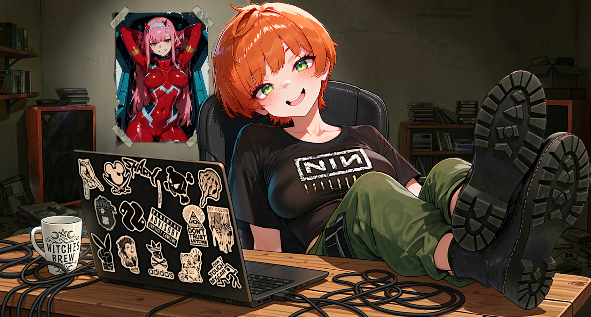

 

 

> *"You can't kill what's already dead"*
>
> *"il Laboratorio di Mario, dove la droga divampa e di figa ce n'è tanta..."*  
> Hello I am Mario and Mario's laboratory tales are all true. And by true, I mean false. It's all lies. But they're entertaining lies. And in the end, isn't that the real truth? The answer is: No

**Welcome to the Lab.**  
I started on an Amiga, moved to PC by mistake, and learned to code because school wasn't going to teach me. Now I write software during degen hours, run Linux, and build utilities that actually do what they say on the tin. No corporate bloat, no telemetry, no performative roadmaps. Some code doesn't just run. *It haunts*. I build for myself first, fueled by heavy FLAC archives and algorithm-fed playlists, and I share the binaries if they work.

---

| `[IMGCRUNCH]` | `[UNDEADWALLPAPER]` |  
| :--- | :--- |  
| [**IMGCRUNCH 🔬**](https://github.com/maocide/imgcrunch)  Hardware-accelerated forensic image viewer & ELA engine. Pure Rust differential math + multimodal VLM neural autopsy. | [**UNDEADWALLPAPER 📱**](https://github.com/maocide/UndeadWallpaper)  ExoPlayer powered, OpenGL transformed live wallpaper engine. No ads, no tracking. |  
| `[BACKLOG REAPER]` | `[HAVOC_ARCHIVE]` |  
| [**BACKLOG REAPER 💀**](https://github.com/maocide/BacklogReaper)  Desktop-native ReAct AI Agent. Parses local SQLite & Vector Embeddings to roast your digital hoarding. | [**HAVOC (Est. 2008) 🚀**](https://github.com/maocide/havoc)  2D space game built in pure Python 2.5/Pygame. A relic from before off-the-shelf engines. |

---

**HARDWARE & PIPELINE**
*   **Systems:** Linux / Android
*   **Desktop Rice:** [BakaBot GTK](https://github.com/maocide/bakabot-gtk-theme)
*   **Languages:** Amiga Basic, Python, Rust, Dart, VB, C, C#, ASP, PHP, SQL, Java, GLSL, Kotlin (<- *you* read this thing I refuse)
*   **Media:** Gimp, ComfyUI, Local LLMs, VLMs, FFmpeg
*   **Fuel:** Green Tea, Kava 🍃, Sonic Aggression

**COMMUNICATIONS**
*   **Issues:** I have no issue. 
*   **Roadmaps:** Non-existent. 
*   **Support:** I hope it compiles.

 

MusicImp 👿 broadcasting pirate radio
 

<!--

-->
 
 

> **⚠️ DISCLOSURE**
> 
> 
> LLMs may have been utilized to assist in the production or conceptualization of certain software or visual assets. However, all final architectural and artistic decisions were strictly enforced by demi-human intervention. No LLMs were harmed during production.
> 
> Furthermore, all fictional entities, digital waifus, and anthropomorphic representations depicted herein are categorically 18 years of age or older at the time of drawing, editing or generating, regardless of spatial-temporal paradoxes, suspension of disbelief, or stylistic proportions.
